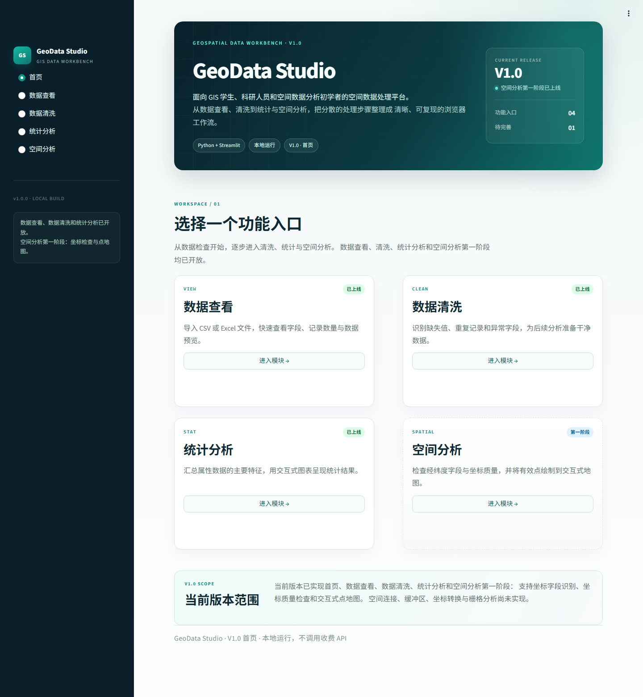
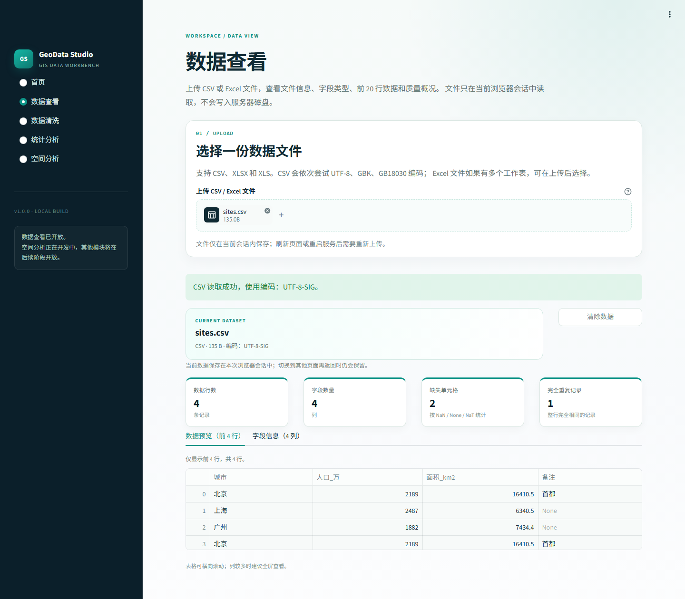
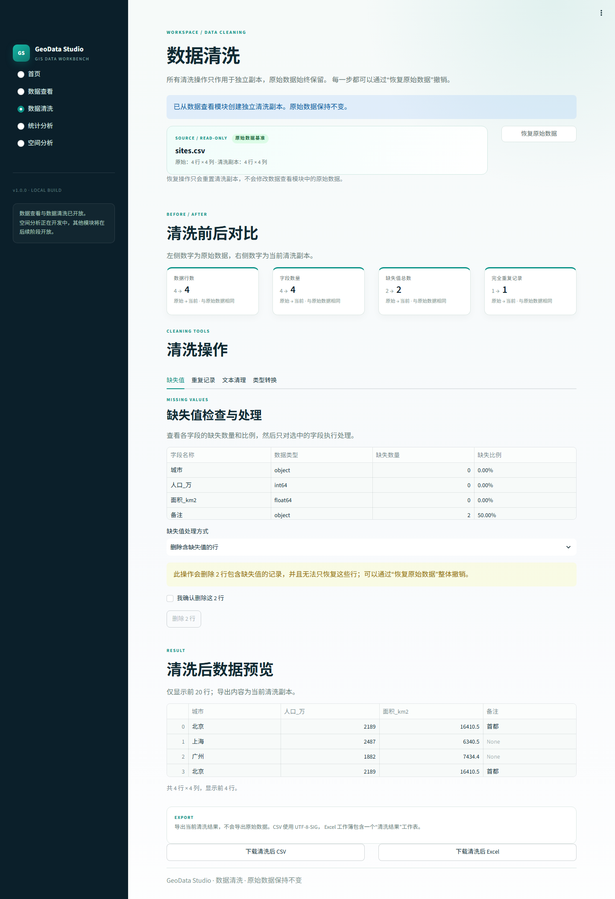
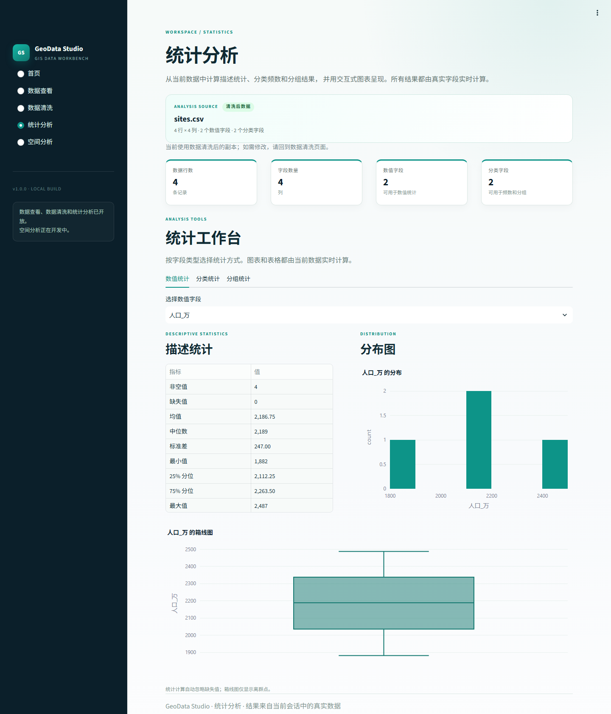
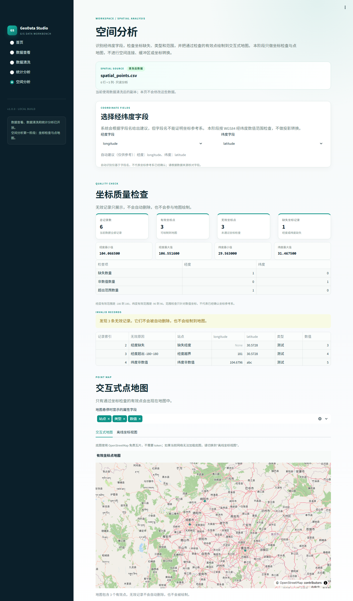

# GeoData Studio

面向 GIS 学生、科研人员和空间数据分析初学者的空间数据处理平台。

当前版本为 `v1.0.0`。首页、**数据查看**、**数据清洗**、**统计分析**已上线；**空间分析第一阶段（坐标检查与点地图）** 已上线。空间连接、缓冲区、坐标转换和栅格分析尚未实现。



## 已实现功能

### 首页

- 平台定位与目标用户介绍；
- 四个功能入口：数据查看、数据清洗、统计分析、空间分析；
- 数据查看、数据清洗、统计分析标记为“已上线”；
- 空间分析标记为“第一阶段”。

### 数据查看

- 上传 CSV、XLSX、XLS 文件；
- CSV 自动尝试 UTF-8、GBK、GB18030 编码；
- Excel 多工作表选择；
- 显示文件名、文件大小、编码或工作表信息；
- 显示数据行数、字段数量和完全重复记录数；
- 字段信息表：字段名称、pandas 数据类型、非空数量、缺失数量、缺失比例；
- 前 20 行数据预览；
- 空文件、损坏文件、错误格式和不支持格式的中文错误提示；
- 数据保存在当前 Streamlit 会话中，切换页面不会丢失；
- 重新上传文件会替换当前会话中的数据；
- 支持手动清除当前数据。



> 截图中的 `sites.csv` 是自动化测试使用的临时文件，不是项目内置数据。

### 数据清洗

- 从数据查看模块获取原始 DataFrame，并保留为只读基准；
- 自动创建独立的清洗副本，所有操作只修改副本；
- 显示清洗前后的行数、列数、缺失值总数和完全重复记录数；
- 缺失值处理：删除行、均值填充、中位数填充、指定值填充；
- 删除完全重复记录；
- 只清理所选文本字段的首尾空格；
- 单字段类型转换：文本、整数、小数、日期时间、布尔值；
- 类型转换失败时显示具体原因，不修改当前数据；
- 删除行和删除重复记录前显示影响行数并要求确认；
- 提供“恢复原始数据”按钮；
- 导出清洗后 CSV（UTF-8-SIG）和 Excel（openpyxl）。



> 截图中的 `sites.csv` 是自动化测试使用的临时文件，不是项目内置数据。

### 统计分析

- 自动优先使用当前有效的清洗副本；没有有效清洗副本时使用原始数据；
- 显示分析数据来源、文件名、行列数、数值字段数和分类字段数；
- 数值统计：非空值、缺失值、均值、中位数、标准差、最小值、25% 分位、75% 分位、最大值；
- 数值字段 Plotly 直方图和箱线图；
- 分类统计：类别频数、占比、缺失类别、Plotly 横向柱状图；
- 分组统计：分类字段 × 数值字段，支持均值、中位数、求和、非空计数；
- 分类图表最多展示 15 类，分组图表最多展示 15 组，分组表最多展示 20 组；
- 所有统计和图表均由当前真实数据实时计算；
- 统计页面只读，不修改原始数据或清洗副本。



> 截图中的 `sites.csv` 是自动化测试使用的临时文件，不是项目内置数据。

### 空间分析：第一阶段

- 优先使用当前有效的清洗副本，否则使用原始数据；
- 自动识别常见经纬度字段名：
  - 经度：`longitude`、`lon`、`lng`、`经度`
  - 纬度：`latitude`、`lat`、`纬度`
- 自动识别结果只是建议，不能证明坐标参考系；
- 允许用户手动选择经度字段和纬度字段；
- 经度和纬度不能选择同一个字段；
- 坐标质量检查：
  - 经度、纬度缺失数量；
  - 非数值坐标数量；
  - 经度是否超出 -180 到 180；
  - 纬度是否超出 -90 到 90；
  - 有效坐标点与无效坐标点数量；
  - 有效点的经纬度最小值和最大值；
- 显示无效记录、记录索引和无效原因；
- 不会自动删除无效记录；
- 只将有效点绘制到地图；
- Plotly Scattermap 交互式点地图；
- 底图使用 OpenStreetMap 免费瓦片，不需要 token；
- 提供“离线坐标视图”，不加载外部底图；
- 地图支持缩放、平移和悬停查看属性。



> 截图中的 `spatial_points.csv` 是自动化测试使用的临时文件，不是项目内置数据。

## 数据状态

```text
st.session_state["data_view_dataframe"]           # 原始数据，只读基准
st.session_state["data_view_metadata"]            # 文件信息
st.session_state["data_clean_dataframe"]          # 独立清洗副本
st.session_state["data_clean_source_signature"]   # 清洗副本对应的数据源
```

- 数据查看上传新文件后，数据清洗会检测数据源变化并重新创建清洗副本；
- 统计分析、空间分析只在清洗副本的数据源与当前文件一致时使用清洗副本；
- 如果清洗副本与当前文件不一致，会回退到原始数据并显示提示；
- 切换页面不会丢失清洗副本；
- 刷新页面或重启 Streamlit 后，所有数据都需要重新上传。

## 当前限制

- 数据只保存在浏览器会话内，刷新页面或重启 Streamlit 后需要重新上传；
- 暂不支持手动指定 CSV 编码或分隔符；
- CSV 空字段由 pandas 默认识别为缺失值；
- 单个上传文件默认上限为 200 MB；
- 均值/中位数填充会把所选数值字段转换为可容纳小数的浮点类型；
- 数据清洗只支持恢复到原始数据，不提供逐步撤销历史；
- 统计分析暂不包含相关性分析、回归、时间序列或空间统计；
- 空间分析只检查经纬度数值范围，不确认坐标参考系；
- 空间分析不执行投影转换、空间连接、缓冲区或栅格分析；
- 经度/纬度自动识别只依据字段名，可能误判或漏判，必须允许人工核对；
- 交互式地图使用外部 OpenStreetMap 瓦片，网络不可用时请使用“离线坐标视图”；
- 切换页面后，Excel 工作表选择器需要重新上传文件才能切换其他工作表，当前选中的工作表数据会保留。

## 运行环境

- Python 3.11.9
- Streamlit 1.66.1
- pandas 2.3.3、NumPy 2.4.6、openpyxl 3.1.5、Plotly 6.9.0
- xlrd 2.0.2（读取旧版 `.xls`）

## 本地运行

```powershell
# 1. 激活虚拟环境
.\.venv\Scripts\Activate.ps1

# 2. 启动应用
python -m streamlit run app.py
```

浏览器打开终端显示的本地地址（默认 `http://localhost:8501`）。

如果 PowerShell 禁止激活脚本，可以跳过激活，直接运行：

```powershell
.\.venv\Scripts\python.exe -m streamlit run app.py
```

## 运行测试

```powershell
.\.venv\Scripts\python.exe -m unittest discover -s tests -v
```

测试覆盖：

- UTF-8 和 GBK CSV、XLSX 多工作表、旧版 XLS；
- 空 CSV、损坏 Excel、不支持格式；
- 缺失值处理、重复记录删除、文本清理、类型转换；
- 清洗前后指标、原始数据不被修改、恢复原始数据；
- CSV / Excel 导出；
- 描述统计、分类频数、分组统计；
- 统计页使用清洗副本和源变化回退；
- 经纬度字段自动识别、手动选择与同字段校验；
- 缺失坐标、非数值坐标、经纬度越界；
- 有效点数量、坐标范围和无效记录原因；
- 地图只包含有效点；
- 空间页使用清洗副本、无数据提示和原始数据不变。

测试中的 `xlwt` 仅用于生成 `.xls` 测试文件，不参与应用运行。

## 项目结构

```text
GeoData_Studio/
├── .streamlit/
│   └── config.toml          # 页面主题与运行配置
├── tests/
│   ├── test_app_state.py    # 页面状态、数据来源和跨页测试
│   ├── test_data_clean.py   # 数据清洗运算与导出测试
│   ├── test_data_spatial.py # 坐标识别、质量检查与地图测试
│   ├── test_data_stats.py   # 统计计算与字段识别测试
│   └── test_data_view.py    # 文件读取与质量统计测试
├── app.py                   # 应用入口、首页与导航
├── data_view.py             # 数据查看页面与文件解析
├── data_clean.py            # 数据清洗页面与清洗运算
├── data_stats.py            # 统计分析页面与 Plotly 图表
├── data_spatial.py          # 空间分析页面、坐标检查与点地图
├── requirements.txt         # 已验证的运行时依赖
├── preview-home.png         # 首页预览
├── preview-data-view.png    # 数据查看页面预览
├── preview-data-clean.png   # 数据清洗页面预览
├── preview-data-stats.png   # 统计分析页面预览
├── preview-data-spatial.png # 空间分析页面预览
├── README.md
└── .gitignore
```

## 后续开发顺序

1. 空间分析第二阶段：坐标参考系确认与坐标转换；
2. 空间连接与属性关联；
3. 缓冲区分析和叠加分析；
4. 栅格分析。

所有后续空间功能都应明确坐标系、输入数据和输出结果，不得在未确认坐标参考系时静默转换数据。

每一步都应使用真实数据，并在界面上明确显示数据来源与处理状态。
